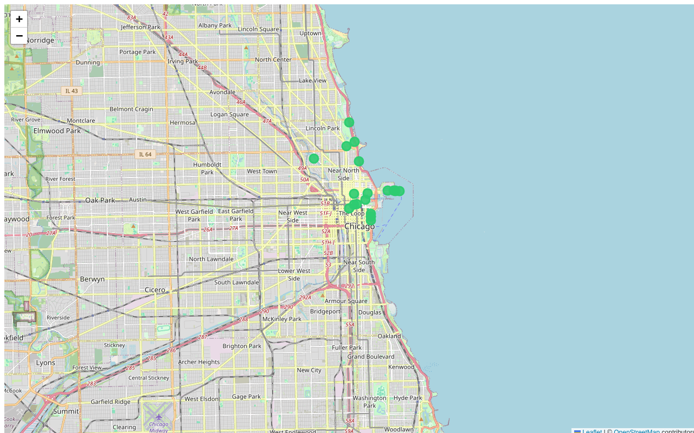
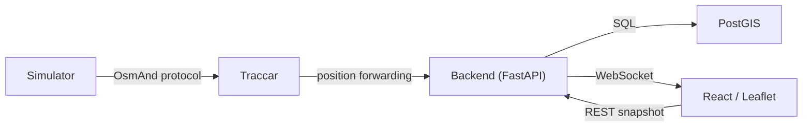

# Routing Brain

A small, working demo of the core of a fleet-dispatch system for tow trucks:
simulated trucks driving real Chicago streets, tracked live through
[Traccar](https://www.traccar.org/), stored in PostGIS, and shown moving on a
live map pushed over a WebSocket. It's built to demonstrate picking up an
unfamiliar stack (Traccar, PostGIS, WebSockets, React/Leaflet) quickly and
building it correctly with AI tools — not a finished product.



## Architecture

See [`docs/architecture.md`](docs/architecture.md) for the full diagram and
notes. In short:



## Running it

```bash
docker compose up --build
```

That's it — no `.env` file is required (every variable has a sane inline
default; copy `.env.example` to `.env` only if you want to override a port or
add a Google Routes API key later). Then open:

- **Live map:** http://localhost:5173
- **Backend health check:** http://localhost:8000/health
- **Traccar admin UI:** http://localhost:8082 (login: `admin@routing-brain.local` /
  `routing-brain`, from `.env.example` — local-demo credentials only, not meant
  to be exposed beyond your own machine)

`docker compose down -v` tears everything down, including the Traccar device
registry and all stored positions.

### Demo: making a truck go "stale"

Nothing in normal simulator traffic ever produces a stale truck, since all 20
keep sending positions continuously. To demonstrate it:

```bash
curl -X POST http://localhost:5001/simulator/pause/truck-10
# wait more than STALE_THRESHOLD_SECONDS (120s by default) — truck-10 goes grey
curl -X POST http://localhost:5001/simulator/resume/truck-10
# truck-10 resumes from where it paused, not teleported ahead
```

Markers use four colors: green (`available`), grey (`stale`), dark
slate-blue `#34495e` (`off_shift` — the truck's seeded driver shift hasn't
started yet, or has already ended), and blue `#3498db` (`en_route` — the
truck is currently assigned to a non-completed tow call). `off_shift` takes
visual precedence over `en_route` and `stale` when more than one would
apply. Trucks `truck-01` and `truck-11` are seeded with an already-ended
shift, so they render off-shift from boot. Every status transition —
including turning blue on confirm and clearing back to green on
complete — updates the marker's color live within the same browser
session; no page reload required.

## What's real and what's simplified

**Real:**
- Traccar's actual position-forwarding feature, configured and verified
  against a live container (not assumed from docs) — the backend receives
  genuine Traccar-shaped payloads, the same way it would from a real device.
- The dedup/out-of-order/duplicate decision logic (`decide()` /
  `apply_decision()`) is a pure, unit-tested function, not an assumption —
  7 tests, run in CI on every push.
- The 20 simulated routes are real Chicago street geometry, fetched once from
  the public OSRM routing engine and committed — the simulator has zero
  runtime dependency on that public server.
- The live map is genuinely live: an initial REST snapshot, then WebSocket
  pushes on real accepted positions only (not polling, not a timer).
- Truck status (`available`/`stale`/`off_shift`/`en_route`) is computed
  continuously against the viewer's own clock and live assignment state —
  never stored, never goes stale itself.
- The assignment engine is real, end to end: a PostGIS candidate prefilter
  (matching truck type, currently on shift, not already assigned to a
  non-completed call, nearest ~10 by real meters distance via a
  `::geography` cast) feeds a pure, unit-tested `rank_candidates()`
  function, and the confirm endpoint re-checks that specific truck's
  eligibility fresh against the database rather than trusting the
  candidate list it returned at create time.
- Double-dispatching one truck to two tow calls at once is actually
  prevented, not just discouraged: `assign_truck()`'s atomic conditional
  `UPDATE` closes the normal race, and a database-level partial unique
  index (`tow_calls_one_active_assignment_per_truck`, on
  `tow_calls(assigned_truck_id) WHERE status != 'completed'`) is the real
  backstop underneath it — Postgres itself refuses a second concurrent
  assignment via index-level conflict detection, independent of
  per-statement snapshot timing. This is the one schema change made
  during Milestone 5, despite this plan's original "no schema changes"
  constraint: it closes a genuine TOCTOU race under PostgreSQL's READ
  COMMITTED isolation and was judged worth the exception.

**Simplified, on purpose, for a 2-day demo:**
- The 20 trucks are simulated, not real Teltonika hardware — the simulator
  speaks the same protocol a real tracker would, so swapping it for real
  devices wouldn't require backend changes.
- No authentication anywhere, including the Traccar admin UI's published
  credentials — fine for a local demo, not for anything exposed to the
  internet.
- Traccar keeps its own embedded H2 database rather than living in PostGIS —
  it's not where this demo's real data lives.
- The schema is one idempotent `schema.sql` applied on every backend
  startup, not versioned migrations (there's only ever going to be one
  schema file in a project this size).
- Only the pure decision logic is unit-tested. The PostGIS upsert/constraint
  behavior, the Traccar integration, and the frontend are all verified by
  running the real stack and checking real output — not by an automated
  suite. That's a real coverage gap, named rather than hidden: the part of
  this system least familiar going in (PostGIS SQL under a non-transactional
  read-then-write) is exactly the part with no automated regression net.
- `on_job` is unreachable in practice: there's no real arrival-detection
  signal (no geofence, no driver action) that would ever move a truck into
  it, so it's named honestly in the status model rather than faked with a
  timer or a fabricated trigger.
- "Mark complete" is a dispatcher convenience this milestone added beyond
  the original brief — a manual button, not a real job-completion
  detection mechanism. Nothing watches the truck's actual position to
  infer that a tow is done.
- `GoogleRoutesEta` is implemented against Google's documented
  `computeRouteMatrix` request/response shape, but has never been
  exercised against a real API key — none was available in this
  environment. `DistanceBasedEta` (straight-line haversine distance at a
  fixed urban speed) is what every live demo actually uses; the two are
  interchangeable behind one `EtaProvider` interface, selected by whether
  `GOOGLE_ROUTES_API_KEY` is set.
- No daily route planning yet — see Status below.

## Status

- [x] **Stack boots** with one `docker compose up`
- [x] **Tracking pipeline** — positions flow simulator → Traccar → backend →
  PostGIS, with dedup/out-of-order handling
- [x] **Live console** — WebSocket-driven map, real route replay, manual
  stale-trigger toggle for demoing
- [x] Truck/shift data (truck types, driver shifts)
- [x] **Assignment engine** — PostGIS candidate prefilter, pure-function
  ranking, stateless confirm-time eligibility recheck, and a
  database-enforced guarantee against double-assigning one truck
- [ ] ETA refresh (background job, pushed live)
- [ ] Daily route planning with OR-Tools (nice to have)

## What I'd do differently for 150 real trucks in production

- **Phased rollout**: a handful of trucks/dispatchers first, running
  alongside whatever they use today, before cutting over the whole fleet.
- **Monitoring**: alerting on ingest error rate, WebSocket client count,
  position-lag per truck — not just "is the container up."
- **Tracker gaps**: a real tracker loses signal in garages/underpasses far
  more than this simulator ever does; the staleness threshold and the
  dispatcher UI both need to make "no signal" visually distinct from "idle."
- **Google Routes API cost and quotas**: this demo's ETA interface is
  designed so the distance-based default and a real Google Routes provider
  are interchangeable behind one interface — but `GoogleRoutesEta` has
  never run against a live key in this project, so production would need
  that first real exercise plus quota/cost monitoring and a fallback path
  when the quota is hit.
- **Dispatcher override**: any ranked suggestion needs a manual override path
  — dispatchers know things the system doesn't (a truck that's actually
  broken down, a driver near end-of-shift).
- **On-call**: a position-ingest pipeline feeding a live dispatch console is
  the kind of thing that needs a real on-call rotation once it's load-bearing
  for actual tow calls, not just a demo.

## Built with AI

This was built with Claude Code, using a structured plan-implement-review
cycle per milestone: a written implementation plan, a fresh review of every
task's diff against its own requirements, and a final whole-branch review
after each milestone — specifically looking for things no single task's
narrow diff would reveal. That last step caught real issues a per-task view
missed, including: a deterministic route-offset point that happened to land
in Lake Michigan, a route-replay interpolation bug that could extrapolate
past a route's real geometry near turnarounds, and — most seriously — a
missing CORS header that would have left the live map permanently blank in
any real browser, since every task's own verification was done via `curl`
and WebSocket clients, not an actual browser. All were found and fixed before
being called done, not left for a reviewer to discover. Traccar's actual API
behavior (no default admin account, email-keyed auth, the real
position-forwarding payload shape) was verified by decompiling and probing
the live, pinned container rather than trusted from documentation.
