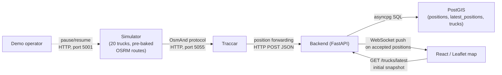

# Architecture

Two independent chains meet at the backend:

- **Tracking chain**: the simulator sends fake GPS fixes to Traccar exactly
  the way a real Teltonika tracker would (the OsmAnd HTTP protocol). Traccar
  forwards each saved position as JSON to the backend's `POST
  /ingest/position`, which resolves the device, runs a pure `decide()`
  function to classify it as a new position, a historical duplicate, or an
  out-of-order point relative to what's already stored, then writes it to
  PostGIS accordingly.
- **Live-view chain**: the frontend fetches `GET /trucks/latest` once for an
  initial snapshot, then opens a WebSocket for live deltas — pushed only when
  a position is genuinely new, never on a duplicate or a stale/out-of-order
  point. Truck status (`available`/`stale`) is computed continuously in the
  browser from each truck's last-known timestamp; it is never stored.
